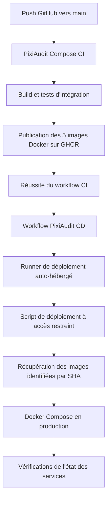

[🇬🇧 English](README.md) | [🇫🇷 Français](README.fr.md)

# PixiAudit — DevOps et Déploiement

## 1. Présentation du projet

PixiAudit est une application web conçue pour automatiser les audits de sites web et générer des recommandations. Elle combine l'exploration de sites web, l'analyse des performances et des recommandations générées par l'intelligence artificielle afin d'évaluer les sites web.

Ce dépôt est consacré à l'**infrastructure DevOps et au déploiement** de PixiAudit. Il regroupe les services de l'application, leur conteneurisation avec Docker, les workflows CI/CD, le déploiement en production ainsi que les procédures de sauvegarde PostgreSQL.

### Objectifs principaux

- Conteneuriser les services de l'application avec Docker.
- Orchestrer les services à l'aide de Docker Compose.
- Mettre en place des workflows CI automatisés avec GitHub Actions.
- Construire et publier les images Docker sur GitHub Container Registry (GHCR).
- Automatiser le déploiement en production à l'aide d'un runner GitHub Actions auto-hébergé.
- Ajouter des vérifications de l'état des services et un mécanisme de rollback.
- Mettre en place des procédures de sauvegarde et de restauration PostgreSQL.

## 2. Vue d'ensemble de l'architecture

PixiAudit repose sur une architecture composée de plusieurs services utilisant Next.js, NestJS, Python, Node.js, PostgreSQL, Redis et Ollama.

### Diagramme de l'architecture applicative


flowchart TB
    User["Utilisateur / Navigateur"]
    Frontend["Frontend<br/>Next.js<br/>:3000"]
    Backend["API Backend<br/>NestJS<br/>:3001"]
    Redis[("Redis<br/>File d'attente Bull")]
    Scraper["Service de scraping<br/>Python FastAPI<br/>:8002"]
    Lighthouse["Service Lighthouse<br/>Node.js + Chrome<br/>:8003"]
    AI["Service d'analyse IA<br/>Python FastAPI<br/>:8000"]
    Ollama["Ollama<br/>Mistral"]
    PostgreSQL[("PostgreSQL<br/>Base de données")]

    User --> Frontend
    Frontend <-->|"API REST"| Backend

    Backend -->|"Mise en file d'attente du job d'audit"| Redis
    Redis -->|"Job disponible"| Backend

    Backend -->|"Tâche de scraping"| Scraper
    Scraper -->|"Résultats du scraping"| Backend

    Scraper -->|"Demande d'audit des performances"| Lighthouse
    Lighthouse -->|"Résultats de performance"| Scraper

    Backend -->|"Demande de recommandations IA"| AI
    AI -->|"Recommandations IA"| Backend

    AI -->|"Génération des recommandations"| Ollama
    Ollama -->|"Réponse générée"| AI

    Backend <-->|"Lecture / écriture des données d'audit"| PostgreSQL

    classDef frontend fill:#dceeff,stroke:#3286c8,color:#17324d,stroke-width:1.5px
    classDef backend fill:#e8e0ff,stroke:#8560d8,color:#30204f,stroke-width:1.5px
    classDef processing fill:#e1f3e5,stroke:#4b9b61,color:#193d25,stroke-width:1.5px
    classDef infrastructure fill:#fff0d9,stroke:#d99427,color:#57380c,stroke-width:1.5px
    classDef user fill:#e5f2ff,stroke:#c8d9e8,color:#174a7e

    class User user
    class Frontend frontend
    class Backend backend
    class Scraper,Lighthouse,AI processing
    class Redis,Ollama,PostgreSQL infrastructure


### Services et responsabilités

| Service | Technologie | Responsabilité |
|---|---|---|
| Frontend | Next.js, React, TypeScript | Interface utilisateur et gestion des audits |
| Backend | NestJS, TypeORM | API REST, authentification, logique applicative et gestion de la file d'attente des audits |
| Scraper | Python, FastAPI | Exploration des sites web et collecte des données |
| Lighthouse | Node.js, Chrome | Analyse des performances des sites web avec Lighthouse |
| Service IA | Python, FastAPI | Génération de recommandations à l'aide du modèle d'IA |
| Ollama | Ollama, Mistral | Exécution du modèle de langage local |
| PostgreSQL | PostgreSQL 17.11 | Stockage persistant des données applicatives et des audits |
| Redis | Redis 7.4.11 | Gestion des files d'attente et des tâches en arrière-plan avec Bull |

### Flux de traitement d'un audit

1. L'utilisateur soumet une demande d'audit depuis le frontend Next.js.
2. Le backend NestJS reçoit la demande et gère le processus d'audit.
3. Le backend utilise Redis et Bull pour gérer les tâches d'audit en arrière-plan.
4. Le scraper collecte les informations du site web.
5. Le service Lighthouse effectue l'analyse des performances à l'aide de Chrome.
6. Le service IA traite les informations de l'audit et communique avec Ollama afin de générer des recommandations.
7. Le backend et les services de traitement enregistrent les résultats correspondants dans PostgreSQL.
8. Le frontend affiche les résultats de l'audit et les recommandations.

## 3. Structure du dépôt

```text
pixiaudit-devops/
├── .github/
│   └── workflows/
│       ├── ai-service-ci.yml
│       ├── backend-ci.yml
│       ├── frontend-ci.yml
│       ├── scraper-lighthouse-ci.yml
│       ├── compose-ci.yml
│       └── deploy.yml
│
├── ai-service/
├── backend/
├── frontend/
├── scraper/
├── lighthouse/
│
├── ci-mocks/
│   ├── lighthouse/
│   └── ollama/
│
├── docs/
│   └── backup-recovery.md
│
├── docker-compose.yml
├── docker-compose.ci.yml
├── docker-compose.deploy.yml
├── deploy.sh
├── backup-postgres.sh
└── README.md
```

## 4. Conteneurisation avec Docker

Chaque service applicatif possède son propre Dockerfile, ce qui permet de construire et de déployer les images indépendamment.

### Builds multi-stage

Le frontend et le backend utilisent des builds Docker multi-stage afin de séparer les dépendances nécessaires à la compilation de l'environnement d'exécution.

Cette approche permet de réduire la taille des images finales et d'éviter d'inclure les dépendances de développement dans les images utilisées en production.

### Conteneurisation spécifique à chaque service

- **Frontend :** utilise une image basée sur Node.js Alpine et le mode standalone de Next.js.
- **Backend :** utilise un environnement de build et d'exécution basé sur Node.js Alpine.
- **Scraper :** utilise Python Slim avec les dépendances nécessaires à l'exploration et à la collecte des données.
- **Service IA :** utilise Python Slim avec FastAPI et le client Ollama.
- **Lighthouse :** utilise Node.js avec Google Chrome installé pour l'analyse des performances via un navigateur.

Les composants Scraper et Lighthouse sont maintenus dans deux services distincts. Cette séparation s'explique par l'utilisation de deux environnements technologiques différents : Python pour le scraping et Node.js pour Lighthouse. Lighthouse nécessite également Google Chrome, ce qui implique des dépendances supplémentaires à l'installation et à l'exécution.

Cette séparation facilite la construction, la configuration, la maintenance et le dépannage de chaque service.

### Docker Compose

Docker Compose orchestre les services applicatifs ainsi que leurs dépendances d'infrastructure.

Le dépôt contient plusieurs configurations Compose adaptées aux différents environnements :

| Fichier | Utilisation |
|---|---|
| `docker-compose.yml` | Environnement Docker local |
| `docker-compose.ci.yml` | Environnement de tests d'intégration CI |
| `docker-compose.deploy.yml` | Environnement de déploiement en production |

## 5. Environnement Docker local

L'environnement Docker local exécute les services applicatifs ainsi que leurs dépendances d'infrastructure.

### Principaux composants

- Frontend
- Backend
- Scraper
- Lighthouse
- Service IA
- Ollama
- PostgreSQL
- Redis

### Organisation du réseau

Docker Compose utilise des réseaux distincts afin de contrôler la communication entre les composants applicatifs et les services d'infrastructure.

Les services communiquent entre eux en utilisant leurs noms de services Compose plutôt que des adresses IP spécifiques à la machine hôte.

### Persistance des données

Des volumes Docker sont utilisés pour préserver les données importantes de l'application, notamment celles de PostgreSQL, Redis et Ollama.

Ainsi, le redémarrage ou la recréation des conteneurs applicatifs ne supprime pas automatiquement les données persistantes stockées dans ces volumes.

## 6. Intégration continue (CI)

GitHub Actions automatise la validation et les tests des différents services de PixiAudit.

### Workflows CI

| Workflow | Responsabilité |
|---|---|
| `frontend-ci.yml` | Validation et build du frontend |
| `backend-ci.yml` | Validation, tests et build du backend |
| `scraper-lighthouse-ci.yml` | Validation du Scraper et de Lighthouse |
| `ai-service-ci.yml` | Validation du service IA |
| `compose-ci.yml` | Tests d'intégration de l'ensemble de l'application avec Compose |

### Tests d'intégration avec Compose

Le workflow Compose CI vérifie le fonctionnement de l'environnement applicatif intégré.

Ses principales étapes sont les suivantes :

1. Valider la configuration Docker Compose.
2. Construire les images des services destinées à la CI.
3. Démarrer l'environnement de tests d'intégration.
4. Utiliser des mocks CI pour les dépendances externes ou nécessitant beaucoup de ressources.
5. Vérifier l'état de santé et la disponibilité des services.
6. Tester les principaux endpoints de l'application.
7. Collecter les logs en cas d'échec.
8. Arrêter et supprimer l'environnement CI.

L'environnement CI utilise des mocks dédiés pour Lighthouse et Ollama. Cela permet d'effectuer les tests d'intégration sans dépendre de l'exécution d'un audit complet basé sur un navigateur ni du téléchargement et de l'exécution du modèle de langage.

### Publication des images Docker

Après la réussite des tests d'intégration Compose, le workflow publie les cinq images applicatives sur GitHub Container Registry (GHCR).

Les images publiées sont associées aux tags suivants :

- `latest`
- Le SHA du commit Git correspondant.

La publication est limitée aux exécutions réussies associées aux pushs vers la branche `main`.

## 7. Déploiement continu (CD)

PixiAudit utilise un runner GitHub Actions auto-hébergé (*self-hosted runner*) pour automatiser le déploiement en production.

Le workflow de déploiement est déclenché après la réussite du workflow Compose CI sur la branche `main`.

### Diagramme de l'architecture de déploiement



### Processus de déploiement

1. Une modification est poussée vers la branche `main`.
2. Le workflow Compose CI construit les images applicatives et exécute les tests d'intégration.
3. Après la réussite des tests d'intégration, les cinq images applicatives sont publiées sur GHCR.
4. Le workflow CD démarre après la réussite du workflow CI.
5. Le runner auto-hébergé invoque le script de déploiement à accès restreint.
6. Le script de déploiement reçoit le SHA exact du commit Git associé à l'exécution CI réussie.
7. Les images identifiées par ce SHA sont récupérées depuis GHCR.
8. Docker Compose met à jour les services applicatifs en production.
9. Des vérifications de santé confirment que les services déployés fonctionnent correctement.

### Runner auto-hébergé

Le runner de déploiement fonctionne sur l'hôte de production et est enregistré au niveau du dépôt GitHub.

Il utilise un compte système dédié nommé `gha-deploy`. Ce compte ne dispose pas d'un accès direct au socket Docker ni de privilèges sudo généraux.

À la place, il est autorisé à invoquer un script de déploiement spécifique appartenant à root, au moyen d'une règle sudoers à accès restreint.

### Script de déploiement et rollback

Le script de déploiement est situé à l'emplacement suivant :

```text
/usr/local/sbin/pixiaudit-deploy
```

Il effectue les opérations suivantes :

- Vérification du SHA du commit demandé.
- Acquisition d'un verrou de déploiement.
- Récupération des images nécessaires.
- Mise à jour des services selon un ordre contrôlé.
- Vérification du résultat du déploiement.
- Tentative de restauration des images précédemment déployées en cas d'échec d'une mise à jour.

Les services applicatifs sont mis à jour dans l'ordre suivant :

1. Lighthouse
2. Scraper
3. Service IA
4. Backend
5. Frontend

PostgreSQL, Redis et Ollama ne sont pas mis à jour dans le cadre de cette séquence de déploiement des images applicatives.

### Déploiement manuel

Le dépôt contient également le script `deploy.sh`, qui permet d'effectuer un déploiement manuel à l'aide de la configuration Compose de production.

Ce script est distinct du script de déploiement à accès restreint utilisé par le workflow CD automatisé.

## 8. Environnement de production

L'environnement de production est orchestré à l'aide du fichier suivant :

```text
docker-compose.deploy.yml
```

### Services de production

| Composant | Image / Technologie |
|---|---|
| Frontend | Image PixiAudit Frontend depuis GHCR |
| Backend | Image PixiAudit Backend depuis GHCR |
| Scraper | Image PixiAudit Scraper depuis GHCR |
| Lighthouse | Image PixiAudit Lighthouse depuis GHCR |
| Service IA | Image PixiAudit AI Service depuis GHCR |
| PostgreSQL | `postgres:17.11` |
| Redis | `redis:7.4.11` |
| Ollama | `ollama/ollama:0.40.11` |

### Configuration de production

La configuration de production comprend :

- Des réseaux Docker dédiés à la communication entre les services.
- Des volumes persistants pour la base de données, Redis et Ollama.
- Des variables d'environnement gérées via `.env.deploy`.
- Des valeurs sensibles fournies à l'aide des secrets Docker Compose.
- Des health checks pour les services applicatifs et d'infrastructure.
- Des ports applicatifs liés à l'interface réseau loopback de l'hôte.

Le frontend et le backend sont exposés sur les adresses suivantes :

| Service | Adresse de liaison sur l'hôte |
|---|---|
| Frontend | `127.0.0.1:3000` |
| Backend | `127.0.0.1:3001` |

Le conteneur frontend utilise explicitement `HOSTNAME=0.0.0.0` afin que le serveur Next.js écoute sur toutes les interfaces réseau du conteneur et puisse être accessible par les health checks Docker et les autres services.

### Variables d'environnement et secrets

Le fichier d'environnement de production est :

```text
.env.deploy
```

Il est exclu du dépôt Git et protégé par des permissions système restrictives.

Les valeurs sensibles, telles que le mot de passe PostgreSQL, le secret JWT et le mot de passe SMTP, sont fournies par des fichiers situés dans le répertoire `secrets/`.

Ces fichiers sont également exclus du dépôt Git et protégés par des permissions restrictives.

## 9. Sauvegarde et restauration PostgreSQL

PixiAudit dispose d'un script automatisé de sauvegarde PostgreSQL :

```text
backup-postgres.sh
```

Ce script crée des sauvegardes PostgreSQL compressées au format personnalisé (*custom format*) à l'aide de `pg_dump`.

### Processus de sauvegarde

Le script de sauvegarde effectue les opérations suivantes :

1. Créer le répertoire de sauvegarde s'il n'existe pas.
2. Générer un nom de fichier de sauvegarde avec un horodatage.
3. Exécuter `pg_dump` à l'intérieur du conteneur PostgreSQL.
4. Écrire la sauvegarde dans un fichier temporaire.
5. Vérifier la sauvegarde à l'aide de `pg_restore --list`.
6. Déplacer le fichier vérifié vers son nom définitif.
7. Supprimer les fichiers de sauvegarde plus anciens que la période de rétention configurée.

### Planification automatisée

Une tâche cron planifie l'exécution du script de sauvegarde chaque jour à 02:00.

```cron
0 2 * * * /home/mahdi/pixiaudit-devops/backup-postgres.sh >> /home/mahdi/pixiaudit-backups/backup.log 2>&1
```

Le répertoire de sauvegarde est stocké séparément du dépôt de l'application.

### Tests de restauration

Un test de restauration a été effectué en restaurant une sauvegarde dans une base de données PostgreSQL de test distincte.

La base restaurée a été vérifiée en comparant les noms des tables et leurs nombres d'enregistrements avec ceux de la base originale.

Le test a porté sur les tables suivantes :

- `users`
- `audits`
- `crawled_pages`
- `performance_results`
- `recommendation_history`
- `security_results`
- `seo_results`
- `audit_settings`

Le test a confirmé que la base restaurée contenait les tables attendues et que leurs nombres d'enregistrements correspondaient à ceux de la base originale.

Pour consulter la procédure complète de sauvegarde et de restauration :

---
