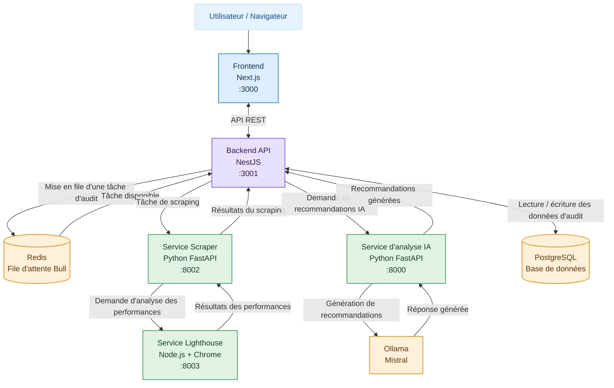
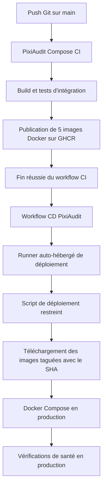

[🇬🇧 English](README.md) | [🇫🇷 Français](README.fr.md)

# PixiAudit — DevOps & Déploiement

## 1. Présentation du projet

PixiAudit est une application web conçue pour automatiser les audits de sites web et générer des recommandations. Elle combine l'exploration de sites web, l'analyse des performances et la génération de recommandations par intelligence artificielle afin d'évaluer les sites web.

Ce dépôt est consacré à l'infrastructure DevOps et au déploiement de PixiAudit. Il regroupe les différents services de l'application, leur conteneurisation avec Docker, les workflows CI/CD, le déploiement en production ainsi que les procédures de sauvegarde de la base de données PostgreSQL.

### Objectifs principaux

- Conteneuriser les services de l'application à l'aide de Docker.
- Orchestrer les services avec Docker Compose.
- Mettre en place des workflows d'intégration continue (CI) avec GitHub Actions.
- Construire et publier les images Docker sur GitHub Container Registry (GHCR).
- Automatiser le déploiement en production à l'aide d'un runner GitHub Actions auto-hébergé (Self-hosted Runner).
- Mettre en place des vérifications de santé (Health Checks) et un mécanisme de retour à la version précédente (Rollback).
- Implémenter des procédures de sauvegarde et de restauration de PostgreSQL.

## 2. Vue d'ensemble de l'architecture

PixiAudit repose sur une architecture multi-services combinant Next.js, NestJS, Python, Node.js, PostgreSQL, Redis et Ollama.

### Diagramme de l'architecture applicative



### Services et responsabilités

| Service | Technologie | Responsabilité |
|---|---|---|
| Frontend | Next.js, React, TypeScript | Interface utilisateur et gestion des audits |
| Backend | NestJS, TypeORM | API REST, authentification, logique applicative et gestion de la file d'attente des audits |
| Scraper | Python, FastAPI | Exploration des sites web et collecte des données |
| Lighthouse | Node.js, Chrome | Analyse des performances des sites web à l'aide de Lighthouse |
| AI Service | Python, FastAPI | Génération de recommandations à l'aide du modèle d'IA |
| Ollama | Ollama, Mistral | Exécution du modèle de langage local |
| PostgreSQL | PostgreSQL 17.11 | Stockage persistant des données de l'application et des audits |
| Redis | Redis 7.4.11 | Gestion des files d'attente et des tâches en arrière-plan avec Bull |

### Processus de traitement d'un audit

1. L'utilisateur soumet une demande d'audit via le frontend Next.js.
2. Le backend NestJS reçoit la demande et gère le processus d'audit.
3. Le backend utilise Redis et Bull pour gérer les tâches d'audit en arrière-plan.
4. Le service Scraper collecte les informations du site web.
5. Le service Lighthouse effectue l'analyse des performances à l'aide de Chrome.
6. Le service IA traite les informations de l'audit et communique avec Ollama afin de générer des recommandations.
7. Le backend enregistre les résultats nécessaires dans PostgreSQL.
8. Le frontend affiche les résultats de l'audit et les recommandations.

## 3. Structure du dépôt

```text
pixiaudit-devops/
├── .github/
│   └── workflows/
│       ├── ai-service-ci.yml
│       ├── backend-ci.yml
│       ├── frontend-ci.yml
│       ├── scraper-lighthouse-ci.yml
│       ├── compose-ci.yml
│       └── deploy.yml
│
├── ai-service/
├── backend/
├── frontend/
├── scraper/
├── lighthouse/
│
├── ci-mocks/
│   ├── lighthouse/
│   └── ollama/
│
├── docs/
│   └── backup-recovery.md
│
├── docker-compose.yml
├── docker-compose.ci.yml
├── docker-compose.deploy.yml
├── deploy.sh
├── backup-postgres.sh
├── README.md
└── README.fr.md
```

## 4. Conteneurisation avec Docker

Chaque service applicatif possède son propre Dockerfile, ce qui permet de construire et de déployer les images indépendamment.

### Builds multi-étapes (Multi-stage Builds)

Le frontend et le backend utilisent des builds Docker multi-étapes afin de séparer les dépendances nécessaires à la compilation de celles requises pour l'exécution.

Cette approche permet de réduire la taille des images finales et d'exclure les dépendances de développement de l'environnement d'exécution en production.

### Conteneurisation spécifique à chaque service

- **Frontend :** utilise une image basée sur Node.js Alpine et le mode standalone de Next.js.
- **Backend :** utilise un environnement de compilation et d'exécution basé sur Node.js Alpine.
- **Scraper :** utilise Python Slim avec les dépendances nécessaires à l'exploration et à la collecte des données.
- **AI Service :** utilise Python Slim avec FastAPI et le client Ollama.
- **Lighthouse :** utilise Node.js avec Google Chrome installé pour effectuer des analyses de performances basées sur un navigateur.

Les composants Scraper et Lighthouse sont maintenus dans des services distincts. Cette séparation s'explique par l'utilisation de deux environnements technologiques différents : Python pour le scraping et Node.js pour Lighthouse. Lighthouse nécessite également Google Chrome, ce qui introduit des dépendances spécifiques à l'installation et à l'exécution.

Cette séparation facilite la construction, la configuration, la maintenance et le dépannage de chaque service.

### Docker Compose

Docker Compose permet d'orchestrer les services applicatifs ainsi que leurs dépendances d'infrastructure.

Le dépôt comprend différentes configurations Compose adaptées aux différents environnements :

| Fichier | Utilisation |
|---|---|
| `docker-compose.yml` | Environnement Docker local |
| `docker-compose.ci.yml` | Environnement de tests d'intégration CI |
| `docker-compose.deploy.yml` | Environnement de déploiement en production |

## 5. Environnement Docker local

L'environnement Docker local exécute les services applicatifs ainsi que leurs dépendances d'infrastructure.

### Principaux composants

- Frontend
- Backend
- Scraper
- Lighthouse
- AI Service
- Ollama
- PostgreSQL
- Redis

### Organisation des réseaux

Docker Compose utilise plusieurs réseaux distincts afin de contrôler la communication entre les composants applicatifs et les services d'infrastructure.

Les services communiquent entre eux en utilisant leurs noms de services Compose plutôt que des adresses IP spécifiques à la machine hôte.

### Persistance des données

Des volumes Docker sont utilisés pour préserver les données importantes de l'application, notamment celles de PostgreSQL, Redis et Ollama.

Cela permet de redémarrer ou de recréer les conteneurs sans supprimer automatiquement les données persistantes stockées dans ces volumes.

## 6. Intégration continue (CI — Continuous Integration)

GitHub Actions automatise la validation et les tests des différents services de PixiAudit.

### Workflows CI

| Workflow | Responsabilité |
|---|---|
| `frontend-ci.yml` | Validation et compilation du frontend |
| `backend-ci.yml` | Validation, tests et compilation du backend |
| `scraper-lighthouse-ci.yml` | Validation des services Scraper et Lighthouse |
| `ai-service-ci.yml` | Validation du service IA |
| `compose-ci.yml` | Tests d'intégration de l'ensemble de l'application avec Compose |

### Tests d'intégration avec Docker Compose

Le workflow Compose CI vérifie le fonctionnement de l'environnement applicatif intégré.

Ses principales étapes sont les suivantes :

1. Valider la configuration Docker Compose.
2. Construire les images des services destinées aux tests CI.
3. Démarrer l'environnement de tests d'intégration.
4. Utiliser des mocks CI pour les dépendances externes ou nécessitant des ressources importantes.
5. Vérifier l'état de santé et la disponibilité des services.
6. Tester les principaux endpoints de l'application.
7. Collecter les logs en cas d'échec.
8. Arrêter et supprimer l'environnement CI.

L'environnement CI utilise des mocks dédiés pour Lighthouse et Ollama. Cela permet d'effectuer les tests d'intégration sans dépendre de l'exécution d'un audit complet basé sur un navigateur ou du téléchargement et de l'exécution du modèle de langage.

### Publication des images Docker

Après la réussite des tests d'intégration Compose, le workflow publie les cinq images applicatives sur GitHub Container Registry (GHCR).

Les images publiées sont identifiées par les tags suivants :

- `latest`
- Le SHA du commit Git correspondant.

La publication est limitée aux exécutions réussies associées à des pushs sur la branche `main`.

## 7. Déploiement continu (CD — Continuous Deployment)

PixiAudit utilise un runner GitHub Actions auto-hébergé (Self-hosted Runner) pour automatiser le déploiement en production.

Le workflow de déploiement est déclenché après la réussite du workflow Compose CI sur la branche `main`.

### Diagramme de l'architecture de déploiement



### Processus de déploiement

1. Une modification est envoyée (push) sur la branche `main`.
2. Le workflow Compose CI construit les images applicatives et exécute les tests d'intégration.
3. Après la réussite des tests d'intégration, les cinq images applicatives sont publiées sur GHCR.
4. Le workflow CD démarre après la réussite du workflow CI.
5. Le runner auto-hébergé invoque le script de déploiement restreint.
6. Le script de déploiement reçoit le SHA exact du commit Git associé à l'exécution CI réussie.
7. Les images correspondant à ce SHA sont récupérées depuis GHCR.
8. Docker Compose met à jour les services applicatifs en production.
9. Les vérifications de santé permettent de confirmer le bon fonctionnement des services déployés.

### Runner auto-hébergé (Self-hosted Runner)

Le runner de déploiement fonctionne sur l'hôte de production et est enregistré au niveau du dépôt GitHub.

Il utilise un compte système dédié nommé `gha-deploy`. Ce compte ne dispose ni d'un accès direct au socket Docker ni de privilèges sudo généraux.

À la place, il est autorisé à exécuter un script de déploiement spécifique, appartenant à l'utilisateur root, via une règle sudoers restreinte.

### Script de déploiement et mécanisme de retour arrière (Rollback)

Le script de déploiement est situé à l'emplacement suivant :

```text
/usr/local/sbin/pixiaudit-deploy
```

Il effectue les opérations suivantes :

- Valide le SHA du commit demandé.
- Acquiert un verrou de déploiement afin d'éviter les exécutions simultanées.
- Récupère les images Docker nécessaires.
- Met à jour les services selon un ordre contrôlé.
- Vérifie les résultats du déploiement.
- Tente de restaurer les images précédemment déployées si une mise à jour échoue.

Les services applicatifs sont mis à jour dans l'ordre suivant :

1. Lighthouse
2. Scraper
3. AI Service
4. Backend
5. Frontend

PostgreSQL, Redis et Ollama ne sont pas mis à jour dans le cadre de cette séquence de déploiement des images applicatives.

## 8. Environnement de production

L'environnement de production est orchestré à l'aide du fichier suivant :

```text
docker-compose.deploy.yml
```

### Services en production

| Composant | Image / Technologie |
|---|---|
| Frontend | Image du frontend PixiAudit provenant de GHCR |
| Backend | Image du backend PixiAudit provenant de GHCR |
| Scraper | Image du Scraper PixiAudit provenant de GHCR |
| Lighthouse | Image de Lighthouse PixiAudit provenant de GHCR |
| AI Service | Image du service IA PixiAudit provenant de GHCR |
| PostgreSQL | `postgres:17.11` |
| Redis | `redis:7.4.11` |
| Ollama | `ollama/ollama:0.40.11` |

### Variables d'environnement et secrets

Le fichier de configuration de l'environnement de production est :

```text
.env.deploy
```

Il est exclu du dépôt Git et ses permissions d'accès sont restreintes.

Les valeurs sensibles, telles que le mot de passe PostgreSQL, le secret JWT et le mot de passe SMTP, sont fournies à travers des fichiers situés dans le répertoire `secrets/`.

Ces fichiers sont également exclus du dépôt Git et protégés par des permissions d'accès restrictives.
## 9. Modèle de sécurité

Cette section documente les contrôles de sécurité qui protègent le déploiement en production. L'objectif est de rendre explicites les frontières de confiance, afin que toute modification d'un contrôle puisse être évaluée par rapport au reste du modèle.

### 9.1 Frontières de confiance

L'architecture de déploiement distingue quatre niveaux de privilèges :

| Niveau | Identité / Emplacement | Ce qu'il peut faire |
|---|---|---|
| Contributeur | Tout compte GitHub disposant d'un accès en écriture | Créer des branches et des pull requests |
| CI | Runners hébergés par GitHub (`ubuntu-latest`) | Construire, tester et publier les images |
| Runner de déploiement | Compte système `gha-deploy` sur l'hôte de production | Invoquer une seule règle sudo restreinte, rien d'autre |
| Déploiement privilégié | `root`, via `/usr/local/sbin/pixiaudit-deploy` | Exécuter Docker Compose sous le compte `mahdi` |

Le compte `gha-deploy` n'appartient volontairement ni au groupe `docker` ni au groupe `sudo`, et il ne peut lire ni `.env.deploy` ni aucun fichier du répertoire `secrets/`.

### 9.2 Protection de la branche `main`

La branche `main` est régie par un ruleset actif nommé `Protect main` :

- Les pushs directs sur `main` sont bloqués — toute modification doit passer par une pull request.
- Les force pushs sur `main` sont bloqués (`non_fast_forward`).
- La suppression de `main` est bloquée.
- La liste de contournement (bypass list) est vide : aucun compte, y compris le propriétaire du dépôt, ne peut contourner ces règles.

Étant donné que le workflow CD ne s'exécute qu'après la réussite du workflow `PixiAudit Compose CI` sur `main`, chaque modification déployable est liée à une pull request et à une exécution CI réussie.

Le ruleset n'exige actuellement **pas** d'approbation. Ce choix est volontaire pour un dépôt maintenu par une seule personne : GitHub n'autorise pas l'auteur d'une pull request à approuver sa propre PR, donc exiger une approbation bloquerait chaque modification. La propriété réellement garantie est plutôt : « aucun push direct, aucun force push, chaque déploiement provient d'une PR validée par la CI ».

### 9.3 Restrictions sur le déclenchement du déploiement

Le workflow CD est déclenché par la fin d'un workflow (`workflow_run`), et sa condition `if:` rejette toute exécution qui ne réunit pas **tous** les critères suivants :

- Une exécution **réussie** du workflow Compose CI.
- Déclenchée par un événement **push** (et non par une pull request).
- Ciblant la branche **`main`**.
- Provenant du **même dépôt** (`head_repository.full_name == github.repository`).

Il en résulte que les pull requests — y compris celles ouvertes depuis des forks — ne peuvent pas atteindre le runner auto-hébergé, même si elles modifient les fichiers de workflow.

### 9.4 Sudo restreint et script de déploiement

Le compte `gha-deploy` ne dispose que d'une seule permission sudo :

```text
(root) NOPASSWD: /usr/local/sbin/pixiaudit-deploy ""