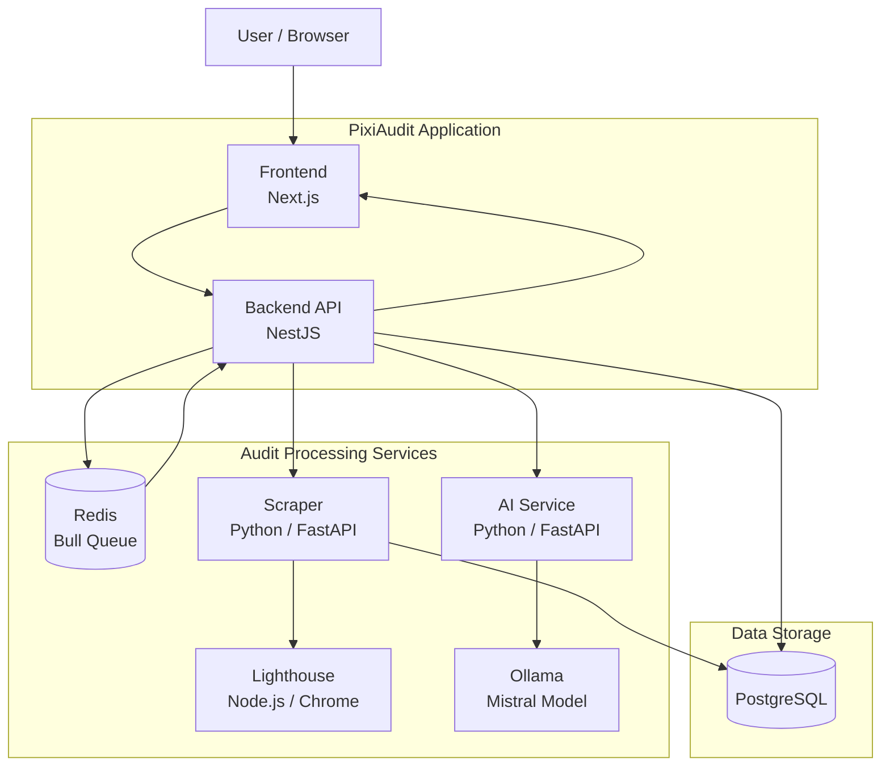
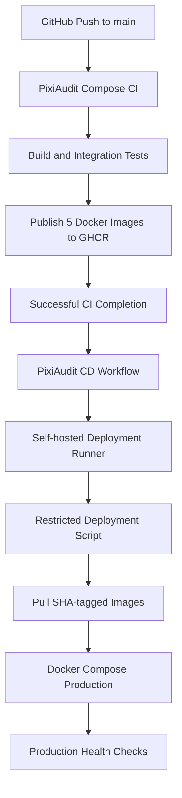

# PixiAudit — DevOps & Deployment

## 1. Project Overview

PixiAudit is a web application designed to automate website audits and generate recommendations. It combines web crawling, performance analysis, and AI-generated recommendations to help evaluate websites.

This repository focuses on the **DevOps and deployment infrastructure** of PixiAudit. It brings together the application services, Docker containerization, CI/CD workflows, production deployment, and PostgreSQL backup procedures.

### Main objectives

- Containerize the application services using Docker.
- Orchestrate the services with Docker Compose.
- Implement automated CI workflows using GitHub Actions.
- Build and publish Docker images to GitHub Container Registry (GHCR).
- Automate production deployment through a self-hosted GitHub Actions runner.
- Add deployment health checks and rollback handling.
- Implement PostgreSQL backup and recovery procedures.

## 2. Architecture Overview

PixiAudit follows a multi-service architecture combining Next.js, NestJS, Python, Node.js, PostgreSQL, Redis, and Ollama.

### Application architecture diagram



### Services and responsibilities

| Service | Technology | Responsibility |
|---|---|---|
| Frontend | Next.js, React, TypeScript | User interface and audit management |
| Backend | NestJS, TypeORM | REST API, authentication, application logic, and audit queue management |
| Scraper | Python, FastAPI | Website crawling and data collection |
| Lighthouse | Node.js, Chrome | Website performance analysis using Lighthouse |
| AI Service | Python, FastAPI | Generates recommendations using the AI model |
| Ollama | Ollama, Mistral | Runs the local language model |
| PostgreSQL | PostgreSQL 17.11 | Persistent application and audit data |
| Redis | Redis 7.4.11 | Queue and background-job management through Bull |

### Audit processing workflow

1. The user submits an audit request through the Next.js frontend.
2. The NestJS backend receives the request and manages the audit process.
3. The backend uses Redis and Bull to manage background audit jobs.
4. The scraper collects website information.
5. The Lighthouse service performs performance analysis using Chrome.
6. The AI service processes audit information and communicates with Ollama to generate recommendations.
7. The backend and processing services persist the relevant results in PostgreSQL.
8. The frontend displays the audit results and recommendations.

## 3. Repository Structure

```text
pixiaudit-devops/
├── .github/
│   └── workflows/
│       ├── ai-service-ci.yml
│       ├── backend-ci.yml
│       ├── frontend-ci.yml
│       ├── scraper-lighthouse-ci.yml
│       ├── compose-ci.yml
│       └── deploy.yml
│
├── ai-service/
├── backend/
├── frontend/
├── scraper/
├── lighthouse/
│
├── ci-mocks/
│   ├── lighthouse/
│   └── ollama/
│
├── docs/
│   └── backup-recovery.md
│
├── docker-compose.yml
├── docker-compose.ci.yml
├── docker-compose.deploy.yml
├── deploy.sh
├── backup-postgres.sh
└── README.md
```

## 4. Dockerization

Each application service has its own Dockerfile, allowing independent image builds and deployments.

### Multi-stage builds

The frontend and backend use multi-stage Docker builds to separate build-time dependencies from runtime environments.

This approach helps reduce the final image size and keeps development dependencies out of the production runtime image.

### Service-specific containerization

- **Frontend:** Uses a Node.js Alpine-based image and Next.js standalone output.
- **Backend:** Uses a Node.js Alpine-based build and runtime environment.
- **Scraper:** Uses Python Slim with the dependencies required for crawling and data collection.
- **AI Service:** Uses Python Slim with FastAPI and the Ollama client.
- **Lighthouse:** Uses Node.js with Google Chrome installed for browser-based performance analysis.

The scraper and Lighthouse components are maintained as separate services. They were separated because the implementation combines two different technology environments: Python for scraping and Node.js for Lighthouse. Lighthouse also requires Google Chrome, which introduces additional installation and runtime dependencies. Separating them makes each service easier to build, configure, maintain, and troubleshoot.

### Docker Compose

Docker Compose orchestrates the application services and infrastructure dependencies.

The repository includes different Compose configurations for different environments:

| File | Purpose |
|---|---|
| `docker-compose.yml` | Local Docker environment |
| `docker-compose.ci.yml` | CI integration-test environment |
| `docker-compose.deploy.yml` | Production deployment environment |

## 5. Local Docker Environment

The local Docker environment runs the application services and their infrastructure dependencies.

### Main components

- Frontend
- Backend
- Scraper
- Lighthouse
- AI Service
- Ollama
- PostgreSQL
- Redis

### Network organization

Docker Compose uses separate networks to control communication between application components and infrastructure services.

The services communicate using their Compose service names rather than relying on host-specific IP addresses.

### Persistent data

Docker volumes are used to preserve important application data, including PostgreSQL, Redis, and Ollama data.

This ensures that restarting or recreating application containers does not automatically remove the persistent data stored in these volumes.

## 6. Continuous Integration (CI)

GitHub Actions automates the validation and testing of the PixiAudit services.

### CI workflows

| Workflow | Responsibility |
|---|---|
| `frontend-ci.yml` | Frontend validation and build |
| `backend-ci.yml` | Backend validation, tests, and build |
| `scraper-lighthouse-ci.yml` | Scraper and Lighthouse validation |
| `ai-service-ci.yml` | AI service validation |
| `compose-ci.yml` | Full-stack Compose integration testing |

### Compose integration testing

The Compose CI workflow validates the integrated application environment.

Its main stages include:

1. Validate the Docker Compose configuration.
2. Build the CI service images.
3. Start the integration-test environment.
4. Use CI mocks for external or resource-intensive dependencies.
5. Check the health and availability of the services.
6. Test important application endpoints.
7. Collect logs if a failure occurs.
8. Stop and remove the CI environment.

The CI environment uses dedicated mocks for Lighthouse and Ollama so that integration testing does not depend on running a full browser-based performance audit or downloading and executing the language model.

### Docker image publishing

After successful Compose integration testing, the workflow publishes the five application images to GitHub Container Registry (GHCR).

The published images are tagged with:

- `latest`
- The corresponding Git commit SHA

Publishing is restricted to successful runs associated with pushes to the `main` branch.

## 7. Continuous Deployment (CD)

PixiAudit uses a self-hosted GitHub Actions runner to automate production deployment.

The deployment workflow is triggered after the successful completion of the Compose CI workflow on the `main` branch.

### Deployment architecture diagram



### Deployment process

1. A change is pushed to the `main` branch.
2. The Compose CI workflow builds the application images and runs integration tests.
3. After successful integration testing, the five application images are published to GHCR.
4. The CD workflow starts after the successful completion of the CI workflow.
5. The self-hosted runner invokes the restricted deployment helper.
6. The deployment helper receives the exact Git commit SHA associated with the successful CI run.
7. The corresponding SHA-tagged images are pulled from GHCR.
8. Docker Compose updates the production application services.
9. Health checks verify that the deployed services are operational.

### Self-hosted runner

The deployment runner operates on the production host and is registered at repository level.

It uses a dedicated system account named `gha-deploy`. The account does not have direct access to the Docker socket or general sudo privileges.

Instead, it is authorized to invoke a specific root-owned deployment helper through a restricted sudoers rule.

### Deployment helper and rollback

The deployment helper is located at:

```text
/usr/local/sbin/pixiaudit-deploy
```

It performs the following operations:

- Validates the requested commit SHA.
- Acquires a deployment lock.
- Pulls the required images.
- Updates services in a controlled order.
- Checks deployment results.
- Attempts to restore previously deployed images if an update fails.

The application services are updated in the following order:

1. Lighthouse
2. Scraper
3. AI Service
4. Backend
5. Frontend

PostgreSQL, Redis, and Ollama are not updated as part of the application image deployment sequence.

### Manual deployment

The repository also contains `deploy.sh`, which provides a manual deployment mechanism using the production Compose configuration.

It is separate from the restricted deployment helper used by the automated CD workflow.

## 8. Production Environment

The production environment is orchestrated using:

```text
docker-compose.deploy.yml
```

### Production services

| Component | Image / Technology |
|---|---|
| Frontend | PixiAudit frontend image from GHCR |
| Backend | PixiAudit backend image from GHCR |
| Scraper | PixiAudit scraper image from GHCR |
| Lighthouse | PixiAudit Lighthouse image from GHCR |
| AI Service | PixiAudit AI service image from GHCR |
| PostgreSQL | `postgres:17.11` |
| Redis | `redis:7.4.11` |
| Ollama | `ollama/ollama:0.40.11` |

### Production configuration

The production configuration includes:

- Dedicated Docker networks for service communication.
- Persistent volumes for database, Redis, and Ollama data.
- Environment variables managed through `.env.deploy`.
- Sensitive values provided through Docker Compose secrets.
- Health checks for application and infrastructure services.
- Application ports bound to the host loopback interface.

The frontend and backend are exposed on:

| Service | Host binding |
|---|---|
| Frontend | `127.0.0.1:3000` |
| Backend | `127.0.0.1:3001` |

The frontend container explicitly uses `HOSTNAME=0.0.0.0` so that the Next.js server listens on all container interfaces and can be reached by Docker health checks and other services.

### Environment and secrets

The production environment file is:

```text
.env.deploy
```

It is excluded from Git and restricted through filesystem permissions.

Sensitive values such as the PostgreSQL password, JWT secret, and SMTP password are provided through files in the `secrets/` directory.

These files are also excluded from Git and protected with restrictive permissions.

## 9. PostgreSQL Backup and Recovery

PixiAudit includes an automated PostgreSQL backup script:

```text
backup-postgres.sh
```

The script creates compressed PostgreSQL custom-format dumps using `pg_dump`.

### Backup process

The backup script:

1. Creates the backup directory if it does not exist.
2. Generates a timestamped backup filename.
3. Runs `pg_dump` inside the PostgreSQL container.
4. Writes the dump to a temporary file.
5. Verifies the dump using `pg_restore --list`.
6. Moves the verified dump to its final filename.
7. Removes backup files older than the configured retention period.

### Automated scheduling

A cron job schedules the backup script to run every day at 02:00.

```cron
0 2 * * * /home/mahdi/pixiaudit-devops/backup-postgres.sh >> /home/mahdi/pixiaudit-backups/backup.log 2>&1
```

The backup directory is stored separately from the application repository.

### Recovery testing

A recovery test was performed by restoring a backup into a separate PostgreSQL test database.

The restored database was checked by comparing table names and row counts with the original database.

The test covered the following tables:

- `users`
- `audits`
- `crawled_pages`
- `performance_results`
- `recommendation_history`
- `security_results`
- `seo_results`
- `audit_settings`

The test confirmed that the restored database contained the expected tables and matching row counts.

For the complete backup and recovery procedure, see:

---

